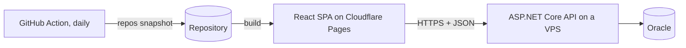

# jade-atlas

Personal portfolio of Yintong Zhou, fullstack .NET software developer in Milan. It shows a profile, projects and a CV, and is the first module of a personal management system that will grow by module (finance, career, health).

[Overview](#overview) · [Getting started](#getting-started) · [GitHub projects](#github-projects) · [Repository structure](#repository-structure) · [Deploy](#deploy)

## Overview

The site has two sides:

- **Public pages:** Home with a WebGPU hero and a stack diagram, Projects, a page for each project, and About with the CV and a PDF download.
- **Private area** (planned): after login, the owner creates, edits, publishes and deletes content through forms.



> [!NOTE]
> The project is in progress. The public frontend works. The backend is still a skeleton (an ASP.NET Core project with OpenAPI, plus an Oracle data project and a test project), so the CV runs on development sample data, and the private area and the deploy pipeline are not built yet. `PROJECT.md` holds the full scope, phases and status.

### Stack

| Layer | Technologies |
| --- | --- |
| Frontend | React 19, Vite, TypeScript, Tailwind CSS, React Router, TanStack Query, React Hook Form + Zod, Motion, AnimeJS, three.js |
| Backend | ASP.NET Core Web API on .NET 10, EF Core with the Oracle provider, ASP.NET Core Identity, OpenAPI |
| Database | Oracle |
| Tests | Vitest + Testing Library (frontend), xUnit (backend) |

## Getting started

### Prerequisites

- [Node.js](https://nodejs.org) 22 or newer
- [.NET 10 SDK](https://dotnet.microsoft.com/download)
- Chrome or Edge, only to regenerate the CV PDF

### Frontend

```bash
cd frontend
npm install
npm run dev
```

The site opens at `http://localhost:5173`. With reduced motion, or on short screens, the Home hero is static.

| Command | What it does |
| --- | --- |
| `npm run dev` | Development server |
| `npm run build` | Type check and production build in `dist/` |
| `npm run lint` | ESLint |
| `npm run test` | Vitest, once |
| `npm run cv:pdf` | Regenerates `public/cv/Yintong_Zhou_CV.pdf` from the CV page (dev server must be running) |

### Backend

```bash
cd backend
dotnet tool restore
dotnet build
dotnet test
dotnet run --project JadeAtlas.Api
```

> [!WARNING]
> Never commit connection strings or secrets. They go in `.env` or .NET user-secrets, both excluded from Git.

## GitHub projects

The Projects page and the Home preview list the owner's public GitHub repositories. Visitors never call GitHub: the site reads a snapshot included in the build.

1. `.github/workflows/refresh-projects.yml` runs every day at 05:00 UTC, and on demand from the Actions tab ("Run workflow").
2. It runs `frontend/scripts/fetch-projects.mjs`, which calls the GitHub API once and writes `frontend/src/shared/api/githubRepos.json`.
3. If the file changed, the workflow commits it to `main`, which triggers a new site build.

Forks, archived repositories, the profile repository and the GitHub Pages repository are filtered out in `frontend/src/shared/api/github.ts`. The newest three by last push appear on the Home.

To refresh the snapshot locally:

```bash
cd frontend
node scripts/fetch-projects.mjs
```

## Repository structure

```
├── frontend/            React + Vite SPA
│   ├── scripts/         CV PDF and GitHub snapshot scripts
│   └── src/
│       ├── modules/     public pages (admin and future modules go here)
│       └── shared/      API client, components, interface texts
├── backend/             ASP.NET Core API, Oracle data layer, xUnit tests
├── .github/workflows/   CI workflows
├── docs/                design plans and session handoffs
├── execution/           deterministic Python scripts
├── directives/          Markdown SOPs for the coding agents
├── PROJECT.md           scope, architecture, phases, status
├── PROFILE.md           owner's public information and site copy
└── brand-guidelines.md  colours, type, layout and motion
```

All fixed interface texts live in `frontend/src/shared/texts.ts`, so a second language can be added later without touching components.

## Deploy

Planned, not set up yet:

- **Frontend:** Cloudflare Pages, root directory `frontend`, command `npm run build`, built on every push to `main`.
- **API:** a GitHub Actions workflow publishes it to an Ubuntu VPS (systemd service behind Caddy) when `backend/` changes, with manual approval for production.
- **Database:** Oracle Autonomous Database. Migrations run as a separate step that the owner approves.

## Working with coding agents

The project is built with Claude Code and Codex. `AGENTS.md` describes how agents work here: they read `PROJECT.md` and `PROFILE.md` first, work one phase at a time, and run the verification commands above before calling a task done.

## Credits

The Home hero adapts [webgpu-black-hole](https://github.com/dgreenheck/webgpu-black-hole) by dgreenheck (MIT). Its license is distributed at `/licenses/webgpu-black-hole.txt`.

Texts, photos and CV data are © Yintong Zhou, all rights reserved.
