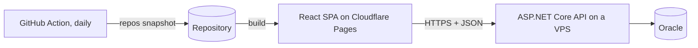

# jade-atlas

Personal portfolio of Yintong Zhou, fullstack .NET software developer in Milan. It shows a profile, projects and a CV, and is the first module of a personal management system that will grow by module (finance, career, health).

[Overview](#overview) · [Getting started](#getting-started) · [GitHub projects](#github-projects) · [Repository structure](#repository-structure) · [Deploy](#deploy)

## Overview

The site has two sides:

- **Public pages:** Home with a WebGPU hero and a stack diagram, Projects (each card opens its GitHub repository directly), and About with the CV and a PDF download.
- **Private area** (planned): after login, the owner creates, edits, publishes and deletes content through forms.



> [!NOTE]
> The project is in progress. The public frontend works. The backend is still a skeleton (an ASP.NET Core project with OpenAPI, plus an Oracle data project and a test project), so the CV runs on development sample data, and the private area and the deploy pipeline are not built yet. `PROJECT.md` holds the full scope, phases and status.

### Stack

| Layer | Technologies |
| --- | --- |
| Frontend | React 19, Vite, TypeScript, Tailwind CSS, React Router, TanStack Query, React Hook Form + Zod, Motion, AnimeJS, three.js |
| Backend | ASP.NET Core Web API on .NET 10, EF Core with the Oracle provider, ASP.NET Core Identity, OpenAPI |
| Database | Oracle |
| Tests | Vitest + Testing Library (frontend), xUnit (backend) |

## Getting started

### Prerequisites

- [Node.js](https://nodejs.org) 22 or newer
- [.NET 10 SDK](https://dotnet.microsoft.com/download)
- Chrome or Edge, only to regenerate the CV PDF

### Frontend

```bash
cd frontend
npm install
npm run dev
```

The site opens at `http://localhost:5173`. With reduced motion, or on short screens, the Home hero is static.

| Command | What it does |
| --- | --- |
| `npm run dev` | Development server |
| `npm run build` | Type check and production build in `dist/` |
| `npm run lint` | ESLint |
| `npm run test` | Vitest, once |
| `npm run cv:pdf` | Regenerates `public/cv/Yintong_Zhou_CV.pdf` from the CV page (dev server must be running) |

### Backend

```bash
cd backend
dotnet tool restore
dotnet build
dotnet test
dotnet run --project JadeAtlas.Api
```

> [!WARNING]
> Never commit connection strings or secrets. They go in `.env` or .NET user-secrets, both excluded from Git.

## GitHub projects

The Projects page and the Home preview list the owner's public GitHub repositories, plus a short hand-written list of repositories of other owners that the owner contributed to. Visitors never call GitHub: the site reads a snapshot included in the build.

1. `.github/workflows/refresh-projects.yml` runs every day at 05:00 UTC, and on demand from the Actions tab ("Run workflow").
2. It runs `frontend/scripts/fetch-projects.mjs`, which reads the owner's repository list and each listed external repository from the GitHub API, looks for a logo in each shown repository (see below) and writes `frontend/src/shared/api/githubRepos.json` and `frontend/public/project-logos/`. If any GitHub call fails, nothing is written and the previous snapshot stays.
3. If those files changed, the workflow commits them to `main`, which triggers a new site build.

Forks, archived repositories, and the profile repository and GitHub Pages repository of each owner (`<owner>` and `<owner>.github.io`) are filtered out in `frontend/src/shared/api/github.ts`. A repository of another owner that merely has the same name as one of the owner's keeps its card. The snapshot is sorted by last push, newest first, then by full name, whoever owns the repository, and the newest three appear on the Home.

### Contributed repositories

Projects of other owners (for example an organisation the owner volunteers for) are listed by hand in `frontend/scripts/external-projects.json`, one `"owner/repo"` string per entry. There is no automatic discovery of contributions: to add a project, add its entry and let the daily workflow pick it up, or refresh locally (below).

```json
[
  "ICPN/subsmate"
]
```

- Only public repositories enter the snapshot. A repository that is private or not reported as public is skipped even if the token can read it, and nothing about it is stored or logged.
- Entries are checked before any request: each must be `owner/repo`, with a valid GitHub owner name. A bad entry stops the run. Entries that differ only by letter case count once, and a repository already in the owner's list is not added twice.
- The metadata and the logo are fetched from the repository's real owner. In the snapshot its slug is `owner/repo` (lower case) and its logo file is `<owner>--<repo>.<ext>`, so it never collides with an owned repository of the same name, whose slug and logo file stay the plain repository name.
- A configured repository that GitHub cannot find (renamed, deleted or made private) stops the run with its name, so the previous snapshot is kept until the entry is fixed or removed. The card links to the repository like every other card.

Each card shows the repository name, description and topics (up to six), and the whole card is one link to its GitHub repository, even when a website is available. A project without a repository URL is shown as a plain tile.

### Project logos

The daily script looks for a logo in each shown repository and copies the best one to `frontend/public/project-logos/<repository>.<ext>`, so visitors request nothing from GitHub. A repository with no usable file shows its name on the tinted block. Logo files are named `<repository>.<ext>` for the owner's repositories and `<owner>--<repository>.<ext>` for other owners'. Only files named like a logo are considered, never arbitrary images, profile photos or owner avatars.

**What counts as a candidate.** An `svg`, `png`, `webp` or `ico` file of at most 512 KiB, at most three folders deep, outside hidden, `node_modules`, `vendor`, `third_party`, `dist`, `build`, test, example, sample, template and demo folders. The name may only use these words, in any order and letter case, separated by `-`, `_` or `.`: `logo`, `icon`, `favicon`, `app`, `apple`, `touch`, `on`, `light`, `black`, `color`, `removebg`, `preview`, `transparent`, a pixel size (`192`, `32x32`), a named size (`small`, `large`...) and the repository name. So `logo.png`, `faixabjj_logo-removebg-preview.png`, `logo-on-light.png`, `app-icon.png`, `apple-touch-icon.png`, `icon-192.png` and `favicon.ico` qualify, while `logo-on-dark.png`, `logo-white.svg`, `icon-maskable-512.png`, `opengraph-image.png` and `profile.png` do not.

**Precedence** (the first difference wins):

1. An explicit logo, then an icon (`icon`, `app-icon`, `apple-touch-icon`), then a favicon.
2. A variant made for a light background (`light`, `black`) before a neutral one.
3. A plain name before an `apple` one (`icon.png` before `apple-icon.png`).
4. The shallowest folder.
5. A file without a size, then the named size closest to 256px.
6. `svg`, then `png`, then `webp`, then `ico`.

If the two best candidates still tie and are different files, the choice is ambiguous and there is no logo. A file over the size limit is skipped and the next best one is used (for example `ark` has a 1 MB `logo.png`, so its 120 KB `icon.ico` is used). The content is checked by its first bytes (PNG, WebP and ICO signatures, an `<svg>` root without scripts), so a Git LFS pointer or an HTML page is never stored.

**Known defaults.** Stock icons of project templates (ASP.NET MVC `favicon.ico`, Vite `favicon.svg`) and the jade-atlas placeholder circle are skipped by their Git blob id, listed in `KNOWN_DEFAULT_ASSETS`. A repository that still uses another template's icon will show that icon until its id is added there.

The rules live in `frontend/scripts/projectLogo.mjs` and are tested in `projectLogo.test.mjs`, including the real file lists of the current repositories.

## Repository structure

```
├── frontend/            React + Vite SPA
│   ├── scripts/         CV PDF and GitHub snapshot scripts
│   └── src/
│       ├── modules/     public pages (admin and future modules go here)
│       └── shared/      API client, components, interface texts
├── backend/             ASP.NET Core API, Oracle data layer, xUnit tests
├── .github/workflows/   CI workflows
├── docs/                design plans and session handoffs
├── execution/           deterministic Python scripts
├── directives/          Markdown SOPs for the coding agents
├── PROJECT.md           scope, architecture, phases, status
├── PROFILE.md           owner's public information and site copy
└── brand-guidelines.md  colours, type, layout and motion
```

All fixed interface texts live in `frontend/src/shared/texts.ts`, so a second language can be added later without touching components.

## Deploy

Planned, not set up yet:

- **Frontend:** Cloudflare Pages, root directory `frontend`, command `npm run build`, built on every push to `main`.
- **API:** a GitHub Actions workflow publishes it to an Ubuntu VPS (systemd service behind Caddy) when `backend/` changes, with manual approval for production.
- **Database:** Oracle Autonomous Database. Migrations run as a separate step that the owner approves.

## Working with coding agents

The project is built with Claude Code and Codex. `AGENTS.md` describes how agents work here: they read `PROJECT.md` and `PROFILE.md` first, work one phase at a time, and run the verification commands above before calling a task done.

## Credits

The Home hero adapts [webgpu-black-hole](https://github.com/dgreenheck/webgpu-black-hole) by dgreenheck (MIT). Its license is distributed at `/licenses/webgpu-black-hole.txt`.

Texts, photos and CV data are © Yintong Zhou, all rights reserved.
